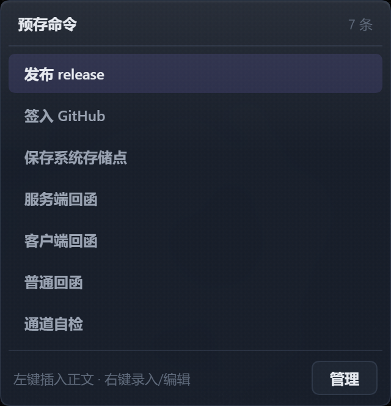
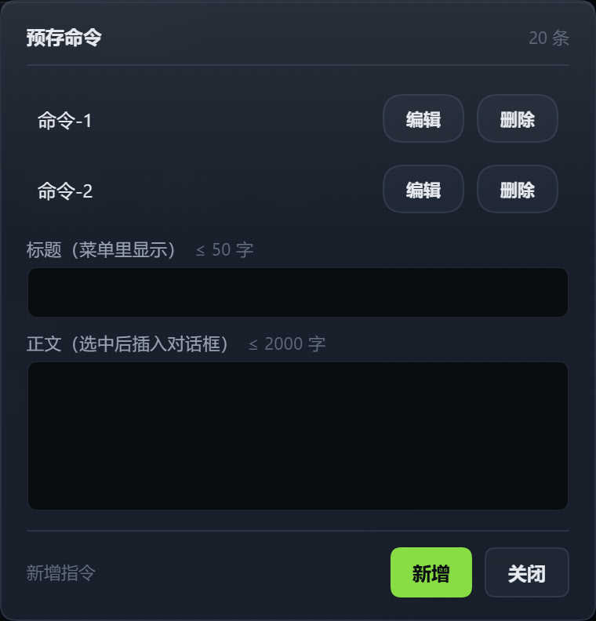
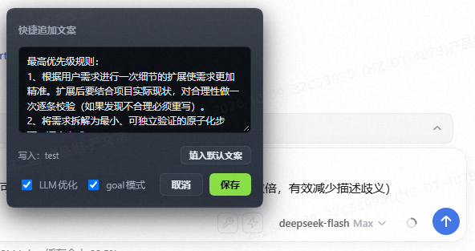
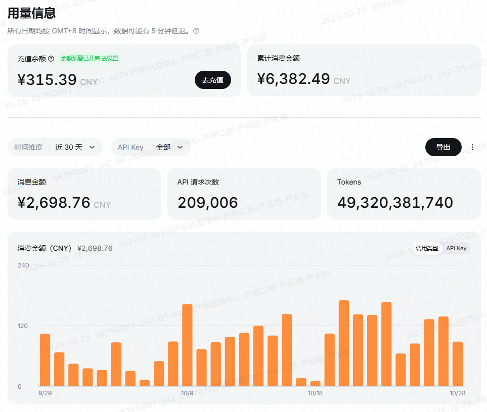
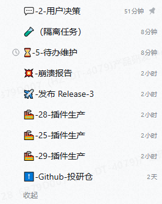
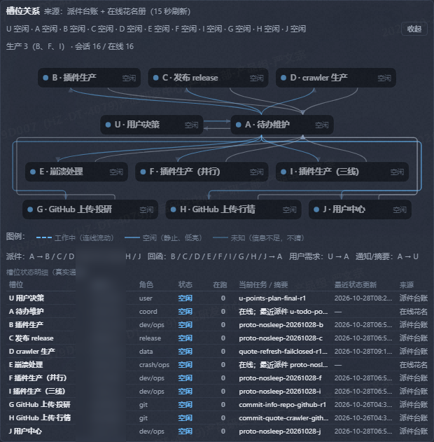

# DSH 扩展坞

**给 DeepSeek Harness（DSH）插上更多接口 —— 4 个开箱即用的插件 + 1 套全自动派发工作流规格包，clone 完不用构建就能装。**

[](LICENSE)
[](#环境要求)
[](#快速上手约-1-分钟)

[English](README.en.md) · 中文

`DSH 插件` · `DeepSeek Harness` · `DeepSeek 外部插件` · `cordis patch bundle` · `AI Agent 提效` · `子代理任务派发` · `全自动派发` · `多智能体工作流`

> **平台说明**：作者当前使用的是 **DeepSeek Harness（DSH）Web 端**进行开发与验证；如果你使用的是 **Desktop 桌面端**，需要自行做兼容化改造（插件加载、WebServer/路由、资源路径、计划任务或权限等），本仓库不保证 Desktop 开箱即用。

---

## 30 秒看懂它能干什么

| 你每天的麻烦 | 插件 | 装上之后 |
| --- | --- | --- |
| 反复贴同一段提示词、同一串命令 | ⚡ **闪电追加** | 一键追加预存文案/命令，**按工作区各存各的**；配 **LLM 优化**：自动读项目说明文档＋最近 3 轮对话，把草稿补成精准需求 |
| 想把一整件事丢给子代理，又受不了中间输出刷屏 | 🧩 **一键派活** | 子代理用 PTC（code）模式写一段程序跑完，中间输出留在程序里，**只把结论路径回给你** |
| 长任务跑着跑着断了、花超了，事后才发现 | 🔔 **报警铃铛** | 被非主动原因中断立刻**分级响铃**；侧栏顺带显示 DeepSeek 对话数与余额 |
| 上下文重复、token 花得快、缓存命中低 | 🧭 **全自动派发** | 用固定槽位与收据/回函纪律复用上下文；作者环境实测 **缓存命中 99.6%**、约 **¥5.47/亿 token** |

四个插件都只在 DSH 侧加载，不改 DSH 源码、不碰你的会话数据；另附一套自动派发工作流规格包。

## 快速上手（约 1 分钟）

```bash
git clone https://github.com/yanwenzong1-pixel/xinlan-dsh-plugin.git
cd xinlan-dsh-plugin

dsh plugin --profile web add ./dsh-quick-append
dsh plugin --profile web add ./dsh-ptc-task
dsh plugin --profile web add ./dsh-dialogue-alert-message

# dsh-auto-dispatch-specification（全自动派发规格包，不是 dsh plugin）
# 按该目录 README 复制 skills/、support/ 并初始化槽位
```

重启 dsh web（或刷新页面）即可。装上「闪电追加」后，输入框右侧会多出 ⚡ 和 🔧 两个按钮。

- `--profile web` 换成你自己的 profile 名（`web` / `headless` / 自定义）即可。
- `dsh plugin … add` 会把插件装进 profile，并**自动把声明了 `dsh.bundle.patch` 的包登记进 `dsh.profile.bundles`**，不需要手改 JSON。
- 卸载：`dsh plugin --profile web remove @dsh-external/dsh-quick-append`。
- **不需要构建**：四个插件的 `lib/` 都已随仓库提交（`main` 直接指向 `lib/index.js`），clone 下来即可加载。
- 🧭 **全自动派发是规格包，不是 `dsh plugin` 插件**：按 [`dsh-auto-dispatch-specification/README.md`](dsh-auto-dispatch-specification/README.md) 复制技能/脚本/配置并初始化槽位即可。
- 🐟 动画桌宠为作者自用，默认不写入上面的快速上手命令；需要时再执行 `dsh plugin --profile web add ./dsh-anime-desktop-pet`。

<details>
<summary>不想用 CLI？手改 profile（等价做法）</summary>

编辑 `<DSH_HOME>/profiles/<name>/package.json`，把插件加进依赖与 bundles 层栈：

```jsonc
{
  "dependencies": {
    "@dsh-external/dsh-quick-append": "link:C:/绝对路径/dsh-quick-append"
  },
  "dsh": {
    "profile": {
      "bundles": [/* 内置 bundle… */, "@dsh-external/dsh-quick-append"]
    }
  }
}
```

然后在该 profile 目录跑一次 `pnpm install`，再重启 dsh web。
</details>

## 界面

| 预存命令菜单（7 条全可见） | 编辑弹窗（视口 460px，20 条可滚动） |
| --- | --- |
|  |  |

> 0.5.2 起，菜单与弹窗都按内容自适应高度、超长列表只有**一个**滚动区，并且装得下就不滚、装不下给滚动提示——不会再出现"列表被裁掉、最后几条点不到"。

## 插件清单

| 别名 | 目录 | 包名 | 版本 | 一句话 |
| --- | --- | --- | --- | --- |
| ⚡ 闪电追加 | [`dsh-quick-append/`](dsh-quick-append/README.md) | `@dsh-external/dsh-quick-append` | 0.5.3 | 输入框「快速追加」按钮 + 预存命令菜单与编辑弹窗（弹窗挂在 body，不被侧栏压住） |
| 🧩 一键派活 | [`dsh-ptc-task/`](dsh-ptc-task/README.md) | `@dsh-external/dsh-ptc-task` | 0.1.0 | 向宿主注册 `ptc_task` 工具，把整件事交给 PTC 作用域子代理 |
| 🔔 报警铃铛 | [`dsh-dialogue-alert-message/`](dsh-dialogue-alert-message/README.md) | `@dsh-external/dsh-dialogue-alert-message` | 0.2.4 | 对话中断分级报警 + 侧栏对话数与余额显示（空间不够自动收成图标；长连接推送 + 45s 兜底） |
| 🧭 全自动派发 | [`dsh-auto-dispatch-specification/`](dsh-auto-dispatch-specification/README.md) | —（工作流规格包） | v1 | 用户决策 → 待办维护 → 执行槽位的自动派发链路；作者环境实测缓存命中 99.6%、约 ¥5.47/亿 token；监控 dashboard 需自建 |
| 🐟 动画桌宠（作者自用） | [`dsh-anime-desktop-pet/`](dsh-anime-desktop-pet/README.md) | `@dsh-external/dsh-anime-desktop-pet` | 0.9.7 | 作者自己使用的简单桌宠+装饰，无推荐功能。 |

### ⚡ 闪电追加 · [详细说明](dsh-quick-append/README.md)

**🔥 重点能力：LLM 优化 —— 把一句草稿补成能直接开工的精准需求**

开启「LLM 优化」后再点闪电，**不是"多接几个字"**：宿主侧 LLM 会先读你的**项目说明文档**与**最近 3 轮对话**，再对提示词做扩充和细节补充。作者自测口径：**大幅降低开发难度；提示词优化后精确度提升数倍，有效减少描述歧义**。

优化上下文由三部分组成（都有代码落点，不是黑盒）：

| 上下文 | 内容 | 依据 |
| --- | --- | --- |
| 你的草稿 | 输入框现有内容（可带图片，多模态一起交给模型） | 请求字段固定 `['draft','context','cwd','images']`，`src/lib/optimize.ts` |
| **项目说明文档** | 项目根 5 份规范（`README.md` + 4 份 SPEC）、`docs/` 全部文档、各插件 `SPEC/README/DESIGN`；按标题剔除「更新日志／变更记录／验收清单／路线图」等非约束章节；带增量缓存，源文件变了才重建，**不写你的仓库** | `src/index.ts:145` → `loadSpecContext(cwd)`；`src/lib/spec-context.ts:19-41` |
| **最近 3 轮对话** | 取最近 6 条 user/assistant 消息拼成上下文，改到一半的活儿也能被正确理解 | `src/client/index.ts:915-927` |



- 输入框右侧两个按钮：**闪电** = 一键追加当前工作区的预存文案；**扳手** = 上拉菜单插入预存命令（左键插入，右键管理）。
- 预存文案**按工作区隔离**并持久化：换项目自动换文案，不会互相污染。
- 右键闪电打开**编辑弹窗**（上图）：写预存文案、勾「LLM 优化」「goal 模式」、点「插入默认文案」。
- **goal 模式**（默认开）：追加时在草稿最前面插入 `/goal`，让这段内容直接作为目标交给 DSH；关掉就是普通提示词。
- 快捷键：输入区聚焦时 `Shift+Alt+F` 等价于点闪电；两个按钮都可 Tab 聚焦，`Shift+F10` 打开右键菜单。

### 🧩 一键派活 · [详细说明](dsh-ptc-task/README.md)

- 注册 `ptc_task` 工具：给 `prompt`（自包含任务说明）和 `resultPath`（产出路径），子代理跑完把结果写进文件。
- 子代理的**工具面以 PTC（code）模式呈现**，一段程序跑完多步操作，中间输出不进你的上下文；主会话工具面保持原生。
- 三道护栏：链长恒 ≤ 1（子代理不能再派发）、递归护栏装不上就**拒发**（fail-closed）、并发去重 + 连续失败熔断。
- 适合「步骤已确定」的批量活（逐项跑脚本、扫描、对账、汇总）；不适合需要边看中间结果再判断的探索型任务。

### 🔔 报警铃铛 · [详细说明](dsh-dialogue-alert-message/README.md)

- 对话正常完成播「叮咚」；被**非用户主动**原因中断时按等级播报警音（工具报错 / 强制取消 / 会话驱逐 / 宿主重启）。
- 只对非主动中断报警：你按的取消不会响。
- 侧栏状态栏显示 DeepSeek 账号用量：对话数 / 余额（v0.2.2 起不再显示「当日花费」，数据仍在 `/api/usage` 中保留）。**v0.2.3 起按可用宽度自适应**：底部动作行被同行插件（如 DSH 内置 Cordis 行）占满时自动收成 12px 图标，完整数据进悬停提示，空间恢复自动还原——不会反过来挤压同行插件。
- **v0.2.4 修「http 换长链后余额数字消失」**：v0.2.3-push 把 1s 轮询改成长连接推送时，宿主侧在 isolate fiber 里直读未 `inject` 的 `typertGateway`，抛错被 `apply` 兜底吞掉 ⇒ 之后的 Web API 路由/余额定时器都没注册，客户端只能拿到 404。现在 gateway 改为 `ctx.get()` 惰性可选读取（网关晚到自动接上、push 失败不提交签名下个 tick 重试），推送块独立 try/catch——推送不可用绝不影响 Web API/余额/报警；客户端首拉失败会按 0/1/3/10s 退避重试。
- 报警走本插件自包含通道（宿主队列 `/api/alarm` → 客户端 WebAudio + ack），不依赖任何第三方插件。

### 🧭 全自动派发工作流 · [规格包](dsh-auto-dispatch-specification/README.md)

把作者已经在生产里跑通的「**用户决策 → 待办维护 → 执行槽位**」自动化开发链路，打包给另一个 DSH 环境复刻。它不是普通插件，而是一套可直接落地的**工作流规格包**：技能 + 规则 + 派单脚本 + 槽位初始化/备份/版本检查。

**🔥 实测收益（作者环境，非通用承诺）**

**Token 缓存命中率 99.6%**


**近 30 天用量：49,320,381,740 tokens / ¥2,698.76**



- **缓存命中率 99.6%**：作者本机 DSH 状态栏实测，稳定使用自动派发后上下文复用率高。
- **每 1 亿 token 成本约 ¥5.47**：`¥2,698.76 ÷ 493.2038174 ≈ 5.47 元/亿 token`，即 5–6 元/亿 token 口径。
- **前提**：严格使用自动派发任务；作者使用开源项目 [Ponytail](https://github.com/DietrichGebert/ponytail) 节省 token；作者全程使用 **DeepSeek V4.1-Flash**。这是作者单一环境数据，不是通用保证；上下文结构、模型价格和调度纪律都会影响结果。

- **默认 7 槽拓扑**：U 用户决策（唯一入口）→ A 待办维护（唯一调度点）→ B/F 生产、C 发布、E 崩溃、G GitHub。一件活只派一个执行槽位；执行方不直接找用户，结果通过回函交回 A→U。
- **收据才算送达**：写进 `outbox/` 只是投邮筒；必须看到 `state/<原名>.done = SENT -> <槽位>` 才算派单成功。同名文件只投一次，重发要换号。
- **派单安全链路**：体检 → 干跑 → 确认 → 收据 → 台账/回函；角色/类型硬拦；规格必须写「判据」和「边界」，问题前置一次问完。
- **两个技能分工**：`y-automation-portable` 负责装/搬/备份/槽位/版本跟随；`y-task-distribution-auto` 是日常派单唯一入口。
- **五条回合纪律**：禁止回合内 sleep 等待；新任务默认入待办；收据才算送达；重启前后先体检与通知；待办清单每次变更都归拢、跑门禁。
- **Windows 本机部署**：计划任务、PowerShell 隐藏壳、DSH profile/槽位均按 Windows 平面设计；不承诺 Linux/macOS。
- **安装不是 `dsh plugin add`**：按规格包 README 的三步复制 `skills/`、`support/` 与配置，再执行 `node scripts/init-slots.mjs --dry-run` 建 7 个默认槽位；通过 `relay-dispatch.mjs check` 做在线体检。

| DSH 槽位会话示意 | 自建监控 dashboard（**不包含在本仓库**） |
| --- | --- |
|  |  |

> ⚠️ **第二张监控 dashboard 不在开源代码里**：它是作者环境自建的可视化面板，仅用于展示槽位关系/在线状态/当前任务/回函观感。本仓库只开源自动化开发流程本身（技能、规则、派单脚本、槽位初始化、备份与版本检查），**不含 dashboard 的前端、后端、数据源或部署代码**；使用者需要自己为自动化流程配一个监控面板，或直接使用 DSH 会话列表与 `relay-dispatch.mjs check/status` 的文本输出。截图中的会话命名、任务标题、槽位 ID 均为演示口径。

### 🐟 动画桌宠（作者自用）

作者自己使用的简单桌宠+装饰，无推荐功能。技术维护/复现文档见 [插件 README](dsh-anime-desktop-pet/README.md)，本页不再展开。


## 先看这条坑（否则可能整个 dsh-web 起不来）

**契约**：凡是列进 profile `dsh.profile.bundles` 的包，`package.json` **必须**声明 `dsh.bundle.patch` 指向真实存在的 `cordis.patch.yml`。缺一个，宿主加载 profile 时会直接报
`profile bundle "<pkg>" declares no dsh.bundle in its package.json` 并退出 —— **爆炸半径是整个 dsh-web（你的所有会话与面板），不是「这个插件不生效」**。

用 `dsh plugin … add` 安装时这一条会自动满足；手改 JSON 时请特别小心。

## 仓库结构

```
dsh-quick-append/            宿主半 src/index.ts + 客户端半 src/client/ + 构建产物 lib/ + 测试 test/
dsh-dialogue-alert-message/  同上（另含 SPEC.md、integration-check.mjs）
dsh-ptc-task/                纯宿主插件：src/index.ts + lib/index.js，无客户端半
dsh-anime-desktop-pet/  独立覆盖层：Client(Shadow DOM 浮层) + Host(GIF 路由) + assets/ + scripts/ + test/
dsh-auto-dispatch-specification/  全自动派发工作流规格包：技能 + 规则 + 派单/槽位/备份脚本（不含监控 dashboard）
docs/                        设计与迭代记录（含界面截图与踩坑过程）
```

每个插件目录内的固定文件：

- `cordis.patch.yml` —— 把该插件插入 profile 层栈的 bundle patch（宿主接入凭据）
- `scripts/build.ps1` —— 构建入口（Windows PowerShell）
- `lib/` —— 已提交的构建产物（含 `lib/types/*.d.ts` 与 sourcemap）

## 平台兼容性

- 作者开发与验证环境：**DeepSeek Harness Web 端**（`dsh web` + 浏览器），Windows 本机 profile。
- 本仓库的插件、全自动派发规格包、动画桌宠均按 **Web 端**编写和验证。
- **Desktop 桌面端需要自行做兼容化改造**：插件加载方式、WebServer/静态资源路由、路径与权限、计划任务/重启方式都可能不同；作者未在 Desktop 上验证，不提供开箱即用保证。

## 环境要求

- DSH ≥ `0.2.1-rc.2`（本仓库在该版本上开发与验证；`web` profile）
- Node.js ≥ 20；加载插件**不需要**构建，改源码才需要
- 构建脚本是 Windows PowerShell（`scripts/build.ps1`，依赖 `$env:DSH_CHECKOUT` 或 `-Checkout` 参数）
- 仓库不提交 `node_modules/`；`lib/` 构建产物**有意**随仓库提交
- 全自动派发规格包面向 **Windows 本机 DSH**（计划任务/PowerShell）；监控 dashboard 不在仓库内

## 开发与测试

```powershell
cd dsh-quick-append
$env:DSH_CHECKOUT = "C:\...\deepseek-harness-dsh-v0.2.1-rc.2"   # 或给 build.ps1 传 -Checkout
npm run build     # build.ps1：建 junction → tsc 编译宿主半 → tsdown 打包客户端半
npm test          # node --test

# typecheck：仓库不在本地装 tsc，直接用 checkout 里的那个
& "$env:DSH_CHECKOUT\node_modules\.bin\tsc.cmd" -p tsconfig.json --noEmit
```

> `npm run typecheck` 需要 PATH 上有 `tsc`（仓库不随包安装），没有就走上面那条命令。

## 搜索关键词 / Keywords

`DSH` · `DSH 插件` · `DeepSeek Harness` · `DeepSeek Harness 插件` · `DeepSeek 外部插件` · `cordis` · `cordis bundle` · `profile bundle` · `预存命令` · `提示词快捷追加` · `prompt preset` · `子代理任务派发` · `subagent dispatch` · `PTC` · `中断报警` · `用量监控` · `AI Agent 提效` · `全自动派发` · `多智能体工作流` · `auto dispatch` · `workflow automation`

## 许可

BSD-3-Clause，见 [LICENSE](LICENSE)。四个插件的 `package.json` 同样声明 `license: BSD-3-Clause`。


